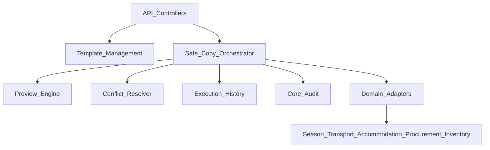

# S08 — Architecture Design (SeasonalTemplates)

> **Status:** `PROPOSED — ENGINEERING DESIGN (Part 0)` · Coding **NOT AUTHORIZED**  
> **Module:** `SeasonalTemplates` (S08-D07)  
> Binding decisions: [OWNER_DECISIONS.md](OWNER_DECISIONS.md)

## 1. Purpose

Provide a **tenant-isolated** capability to:

1. Maintain an **approved** seasonal template library.
2. **Preview** and **execute** safe copies of allowlisted reference/planning data into a **draft** target season (from another season or from a template).

## 2. Module boundaries

| In module | Out of module |
|---|---|
| Template CRUD (metadata + allowlisted selections) | Owning pilgrim/transport/accommodation/procurement domain schemas |
| Orchestrator, preview engine, conflict engine | Unrestricted SQL across domain tables |
| Copy-run history + preview tokens | Audit log storage (uses Core/Audit) |
| Adapter **ports** + registration | Domain business mutations outside approved copy contracts |
| Permission checks for `season_templates.*` / `season_copy.*` | S06 project copy (deferred D08) |

**Proposed code roots (future only):**

- Backend: `backend/app/Modules/SeasonalTemplates/`
- Frontend: `frontend/src/modules/seasonal-templates/`
- Tests: `backend/tests/Feature/SeasonalTemplates/`, Vitest under FE module
- Docs: `docs/09-modules/20-seasonal-templates/`

## 3. Logical components



### 3.1 Template Management

- Stores named templates (`draft` → `approved` → `archived`).
- Payload: ordered list of **allowlist entity kinds** + optional frozen non-PII snapshots produced only from APPROVED matrix rows.
- Publishing to `approved` requires `season_templates.manage` and validation that every kind is APPROVED in the matrix config version.

### 3.2 Safe Copy Orchestrator

Single entry for `mode=from_season|from_template`. Responsibilities:

1. Authorize (`season_copy.preview` / `execute`).
2. Assert same tenant; load source (season or template) + **draft** target season.
3. Expand allowlist ∩ request selection ∩ matrix version.
4. Call adapters for plan → preview or execute.
5. Enforce preview token freshness on execute.
6. Wrap execute in one DB transaction; write history; emit audit.

### 3.3 Domain Safe Copy Adapters (ports)

Interface (conceptual):

```text
SafeCopyAdapter
  - domain(): string
  - supportedEntityKinds(): list
  - plan(context, selection): AdapterPlan  // adds/changes/excludes/conflicts/dateTransforms
  - apply(context, decisions): AdapterResult  // only inside orchestrator transaction
  - fingerprint(context, selection): string  // for preview invalidation
```

Adapters **must**:

- Use tenant-scoped Eloquent / tenant builders (no raw cross-tenant SQL).
- Refuse unknown kinds (fail closed).
- Never read DENY tables for copy payloads (may exist-check only if needed for exclusion reasons without returning PII).
- Own validation of eligible fields.

**Proposed adapter registrations (candidates only):**

| Adapter | Module owner | Candidate kinds |
|---|---|---|
| `SeasonPlanningSafeCopyAdapter` | SeasonPilgrims | `season_programs`, empty `season_pilgrim_groups` |
| `TransportSafeCopyAdapter` | Transportation | points/vehicles link, season vehicles shell, entitlements |
| `AccommodationSafeCopyAdapter` | Accommodation | facility/structure shells, season shells |
| `ProcurementCatalogSafeCopyAdapter` | SuppliersAndProcurement | categories, criteria packs/defs |
| `InventoryMasterSafeCopyAdapter` | Inventory | warehouses/categories/items as shared masters |

No `RisksComplaints` adapter. No `SeasonProjects` adapter until D08 gates pass.

### 3.4 Preview Engine

- Builds aggregated plan from adapters.
- Redacts forbidden attributes.
- Persists preview record + content hash + matrix version + source/target versions.
- TTL + invalidation hooks (see PREVIEW_AND_CONFLICTS.md).

### 3.5 Conflict Resolution

- Classifies conflicts: `DUPLICATE_KEY`, `MANUAL_MODIFIED`, `MISSING_DEPENDENCY`, `DATE_ANCHOR_MISSING`, `KIND_NOT_AUTHORIZED`.
- User resolutions recorded on preview before execute (`skip` \| `overwrite_system` \| `fail`).
- Disallowed resolutions rejected server-side.

### 3.6 Execution History

- Append-only copy-run attempts (`queued` not required for MVP design — sync execute).
- Statuses: `previewed`, `succeeded`, `failed`, `rolled_back` (failed implies transaction aborted; history row still committed in a separate outer write — see AUDIT_AND_TRANSACTIONS.md).

## 4. Tenant isolation

- All SeasonalTemplates tables: `tenant_id` NOT NULL, `TenantOwned` + `UsesTenantScope`.
- Source/target seasons resolved only via tenant scope; cross-tenant IDs → **404** (match platform convention for tenant-owned lookups).
- Adapters inherit tenant context from `TenantContext`; never accept `tenant_id` from client body.

## 5. Transaction boundaries

| Operation | Boundary |
|---|---|
| Preview generate | Read-mostly; writes preview row + hash in short transaction |
| Execute | **Single** transaction spanning all adapter `apply` calls; on any failure → full rollback of domain writes |
| History/audit for failures | History attempt row + audit event committed via **separate** transaction after rollback (or savepoints pattern documented in AUDIT_AND_TRANSACTIONS.md) so attempts remain auditable |

## 6. Error handling

Stable machine codes (proposed):

| Code | When |
|---|---|
| `SEASON_COPY_TARGET_NOT_DRAFT` | Target not draft |
| `SEASON_COPY_SOURCE_INVALID` | Source missing/wrong tenant/status |
| `SEASON_COPY_PREVIEW_REQUIRED` | Execute without preview |
| `SEASON_COPY_PREVIEW_STALE` | Hash/version mismatch |
| `SEASON_COPY_KIND_DENIED` | Kind not on approved matrix |
| `SEASON_COPY_CONFLICT_UNRESOLVED` | Blocking conflict without decision |
| `SEASON_COPY_CROSS_TENANT` | Should be unreachable; mapped to 404 |
| `SEASON_COPY_ADAPTER_FAILED` | Adapter validation failure |

## 7. Extensibility

- New domain: implement adapter + register in provider; add matrix rows; Owner approval; no orchestrator rewrite.
- Matrix versioned config table (or versioned PHP catalog mirrored to DB) so previews pin a version.

## 8. Non-goals

- Full season clone.
- Pilgrim migration tools.
- Live GPS / finance / S06 project copy.
- Background multi-hour clone jobs (Part 0 assumes synchronous bounded batches; large-volume strategy **OPEN-Q**).
